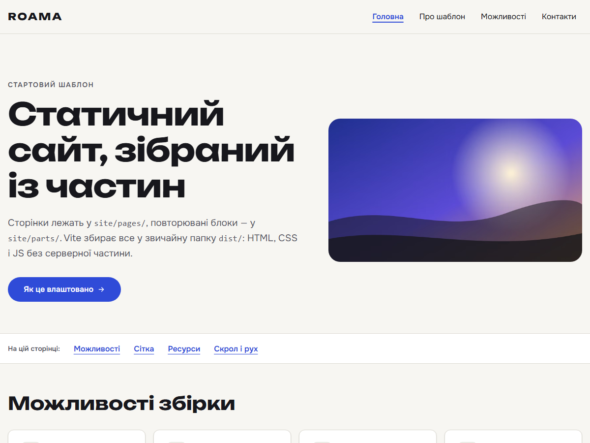

# ROAMA base — WordPress theme

**Потрібен сайт? → [ROAMA, веб-студія](https://robikovach.github.io/roama-studio/)** ·
**Need a website? → [ROAMA web studio](https://robikovach.github.io/roama-studio/)**

## Українською

Безкоштовна класична тема WordPress від веб-студії ROAMA: легка, швидка, з адаптивною версткою від 320 px,
плавним скролом (Lenis), мобільним меню, формою заявок і вмістом, який клієнт редагує сам без ризику
«зламати» сайт.

**Що є в темі**

- Головна, сторінка «Про нас», політика конфіденційності, 404 — у стилі ROAMA (шрифти Onest і Unbounded
  лежать у темі, Google Fonts не потрібні).
- Вміст у **Secure Custom Fields** (SCF): кожне поле з лімітом символів, перемикачі «Показувати секцію»,
  типовий текст, якщо поле порожнє.
- Форма **Contact Form 7** з перевіркою, згодою, захистом від спаму (honeypot) і заявками в **Telegram** та
  **Google-таблицю** (з UTM-мітками і повтором, якщо сервіс недоступний).
- **Імпорт першого вмісту** однією кнопкою або `wp roama import`: сторінки, картинки, поля, форма, меню.
- SEO-основа (title, description, Open Graph), яка поступається SEO-плагіну, якщо він є.
- Доступність: правильні заголовки, фокус з клавіатури, «менше руху» з налаштувань системи.

**Встановлення**

1. Завантажте `roama-theme-<версія>.zip` з [Releases](../../releases).
2. WordPress → «Зовнішній вигляд → Теми → Додати → Завантажити тему» → виберіть zip → «Активувати».
3. Встановіть плагіни **Secure Custom Fields** і **Contact Form 7** (рекомендовано ще **Flamingo**, щоб
   заявки зберігались у WordPress).
4. «Зовнішній вигляд → ROAMA: імпорт вмісту» → «Імпортувати».
5. Налаштування заявок у Telegram і Google-таблицю — `roama/setup/LEADS-SETUP.md`; поля —
   `roama/docs/SCF-FIELDS.md`; усе про сайт для власника — `roama/docs/WP-SETUP.md`.

Потрібно: WordPress 6.5+, PHP 8.1+.

**Ліцензія.** GPL-2.0-or-later (див. `LICENSE`). Шрифти Onest і Unbounded — SIL Open Font License
(`roama/assets/fonts/OFL-*.txt`), Lenis — MIT. Демо-фото можна замінити своїми.

Хочете сайт на цій темі, з вашим дизайном, текстами й налаштованими заявками? Напишіть нам:
**https://robikovach.github.io/roama-studio/**

## English

A free classic WordPress theme by the ROAMA web studio: light and fast, responsive from 320 px, smooth
scrolling (Lenis), a mobile menu, a lead form, and content the client edits without being able to break
the layout.

**What it has**

- Home, About, Privacy policy and 404 pages in the ROAMA style (Onest and Unbounded fonts ship with the
  theme, no Google Fonts).
- Content in **Secure Custom Fields** (SCF): a character limit on every field, «Show section» toggles,
  default text when a field is empty.
- A **Contact Form 7** form with validation, consent, a honeypot, and leads sent to **Telegram** and a
  **Google Sheet** (with UTM tags and a retry queue).
- **First-content import** with one button or `wp roama import`: pages, images, fields, the form, menus.
- An SEO base (title, description, Open Graph) that steps back when an SEO plugin is active.
- Accessibility: proper headings, keyboard focus, the system's «reduce motion» setting.

**Install**

1. Download `roama-theme-<version>.zip` from [Releases](../../releases).
2. WordPress → Appearance → Themes → Add New → Upload Theme → choose the zip → Activate.
3. Install **Secure Custom Fields** and **Contact Form 7** (**Flamingo** recommended, to keep leads in
   WordPress).
4. Appearance → «ROAMA: імпорт вмісту» (content import) → Import.
5. Leads to Telegram and Google Sheets: `roama/setup/LEADS-SETUP.md`; fields: `roama/docs/SCF-FIELDS.md`;
   the owner's guide: `roama/docs/WP-SETUP.md` (the theme's admin texts and docs are in Ukrainian).

Requires WordPress 6.5+ and PHP 8.1+.

**License.** GPL-2.0-or-later (see `LICENSE`). Onest and Unbounded fonts: SIL Open Font License
(`roama/assets/fonts/OFL-*.txt`); Lenis: MIT. Replace the demo photos with your own.

Want a site on this theme with your own design, texts and working lead forms? Contact us:
**https://robikovach.github.io/roama-studio/**
